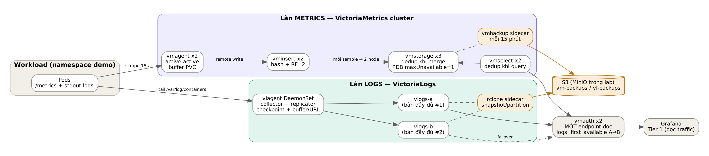

# vm-vl-ha-lab — Lưu trữ metrics & logs HA, tự phục hồi (VictoriaMetrics + VictoriaLogs)

Mini lab dựng tầng lưu trữ **an toàn, chịu lỗi và tự phục hồi** cho dữ liệu traffic mà Tier 1 (module đọc traffic của KLTN) dựa vào để suy luận dependency giữa các service. Nếu tầng này mất dữ liệu, Tier 1 sẽ thiếu flow và sinh NetworkPolicy chặn nhầm traffic hợp lệ. Vì vậy mục tiêu của lab là: **không mất dữ liệu khi một thành phần bất kỳ chết, và tự hồi phục khi mất đĩa.**



## Kiến trúc tóm tắt

| Làn | Thu thập | Ghi | Lưu trữ & nhân bản | Đọc | Bản lạnh |
|---|---|---|---|---|---|
| **Metrics** | 2 × vmagent **active-active** (buffer PVC) | 2 × vminsert | 3 × vmstorage, **RF=2**, dedup 15s | 2 × vmselect (dedup) | vmbackup → S3, mỗi 15 phút |
| **Logs** | vlagent **DaemonSet** (checkpoint + buffer theo đích) | vlagent gửi **đôi** | vlogs-a + vlogs-b (2 bản độc lập) | vmauth `first_available` A→B | snapshot partition + rclone → S3 |

Một endpoint đọc duy nhất: **vmauth** (`/select/0/prometheus/*` cho metrics, `/select/logsql/*` cho logs).

## Chạy nhanh

```bash
make prereqs     # kiểm tra docker/kind/kubectl/jq + image tồn tại
make cluster     # kind: 1 control-plane + 3 worker
make deploy      # triển khai toàn bộ + demo workload, chờ từng tầng Ready
make verify      # TC01: kiểm tra end-to-end (đợi ~2 phút sau deploy)
make ui          # Grafana :3000, VMUI :8427, MinIO :9001
make test-all    # chạy toàn bộ test case chaos (~30 phút)
```

Yêu cầu máy: Docker ≥ 4 CPU / 8 GB RAM, `kind`, `kubectl`, `jq`, `curl`.

## Tài liệu

| # | Tài liệu | Nội dung |
|---|---|---|
| 01 | [Yêu cầu & mục tiêu](docs/01-yeu-cau-va-muc-tieu.md) | Bài toán, yêu cầu chức năng/phi chức năng, tiêu chí thành công |
| 02 | [Thiết kế từng bước](docs/02-thiet-ke-tung-buoc.md) | 9 quyết định thiết kế, phương án bị loại và lý do |
| 03 | [Luồng metrics: dedup & replication](docs/03-luong-metrics.md) | Đi theo 1 sample từ scrape tới query |
| 04 | [Luồng logs: replication ở tầng ingest](docs/04-luong-logs.md) | vlagent, buffer, checkpoint, failover |
| 05 | [Backup & tự phục hồi](docs/05-backup-restore.md) | RPO/RTO, snapshot, restore tự động, resync |
| 06 | [Hướng dẫn triển khai](docs/06-trien-khai.md) | Từng bước, kết quả mong đợi ở mỗi bước |
| 07 | [Runbook lệnh](docs/07-runbook-lenh.md) | Tra cứu nhanh mọi lệnh thao tác |
| 08 | [Test cases](docs/08-test-cases.md) | 10 kịch bản lỗi, cách chạy, kết quả mong đợi |
| 09 | [Xử lý sự cố & lên production](docs/09-troubleshooting.md) | Lỗi thường gặp, checklist chuyển sang EKS |

## Cấu trúc repo

```
vm-vl-ha-lab/
├── Makefile                      # mọi lệnh thao tác
├── kind/kind-config.yaml         # cụm lab 1 CP + 3 worker
├── manifests/
│   ├── base/                     # stack chính (kustomize)
│   │   ├── kustomization.yaml    # ĐỔI PHIÊN BẢN IMAGE Ở ĐÂY
│   │   ├── 0x-*.yaml             # namespace, secret S3, MinIO
│   │   ├── 1x-*.yaml             # vmstorage, vminsert, vmselect, vmagent
│   │   ├── 2x-*.yaml             # VictoriaLogs A/B, vlagent
│   │   ├── 3x-*.yaml             # vmauth, Grafana
│   │   ├── config/               # scrape.yml, vmauth.yml, datasources.yml
│   │   └── scripts/              # script backup/restore chạy TRONG pod
│   └── demo/demo.yaml            # podinfo + flow-generator (log có seq)
├── scripts/
│   ├── 0x-*.sh                   # prereqs, cluster, deploy, verify
│   ├── backup/                   # backup-now, list-backups, vl-resync-partition
│   └── chaos/                    # tc02..tc10 + run-all
├── diagrams/*.dot                # nguồn sơ đồ (graphviz)
└── docs/                         # tài liệu + images/
```

## Phiên bản

Đặt tập trung trong `manifests/base/kustomization.yaml` (VictoriaMetrics `v1.153.0`, VictoriaLogs/vlagent `v1.53.0`). Chạy `make prereqs` để kiểm tra image có pull được không trước khi deploy; nếu tag không tồn tại thì đổi tag ở đó.

Vẽ lại sơ đồ sau khi sửa file `.dot`:

```bash
for f in diagrams/*.dot; do b=$(basename $f .dot); dot -Tpng -Gdpi=160 $f -o docs/images/$b.png; dot -Tsvg $f -o docs/images/$b.svg; done
```
