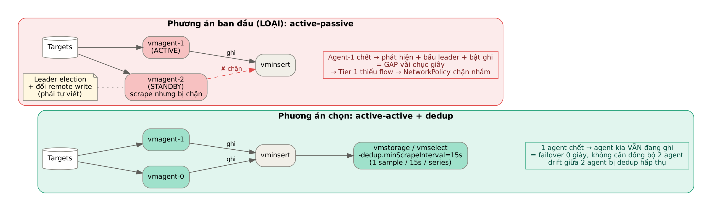
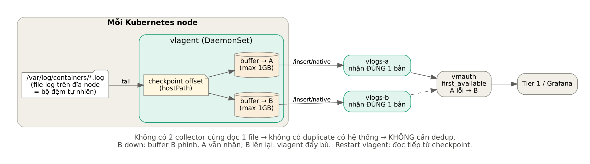
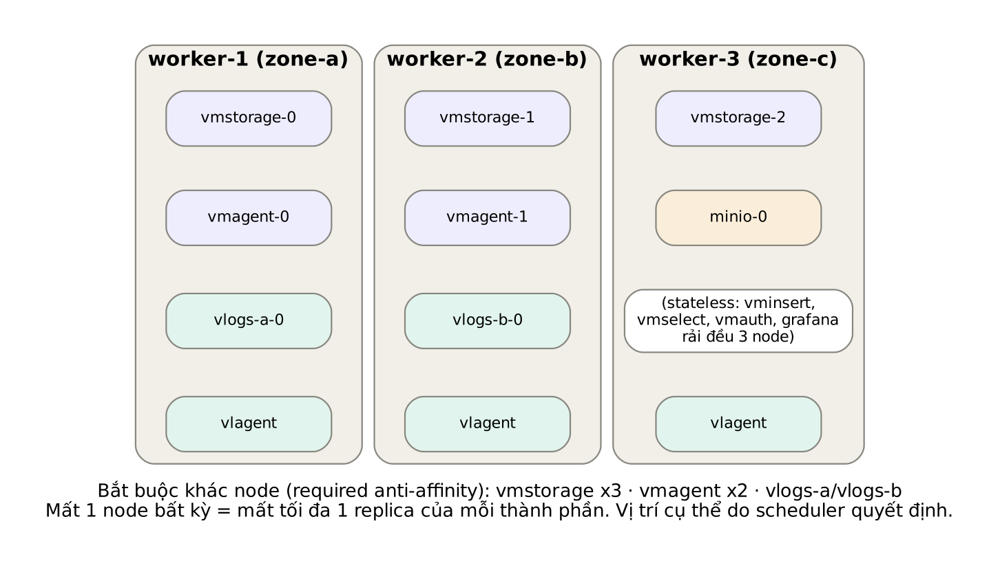

# 02 — Thiết kế từng bước

Tài liệu ghi lại **từng quyết định thiết kế theo thứ tự**, mỗi quyết định có: vấn đề, các phương án, lựa chọn và lý do. Thứ tự này cũng là thứ tự nên trình bày trong báo cáo.

---

## D1. Tầng thu thập metrics: active-active thay vì active-passive

**Vấn đề.** Nếu chỉ có một vmagent thì khi nó chết, metrics bị gián đoạn.

**Phương án ban đầu (bị loại): active-passive.** Hai vmagent cùng scrape, nhưng vmagent-2 bị chặn ở bước remote write. Khi vmagent-1 chết thì vmagent-2 mới được mở. Ý tưởng là giữ "một luồng duy nhất để bảo toàn thứ tự".

Phương án này bị loại vì ba lý do:

1. **Thứ tự không phải là ràng buộc của TSDB.** VictoriaMetrics lưu theo `(series, timestamp)` và chấp nhận sample đến lệch thứ tự. Giữ một luồng duy nhất không đem lại gì.
2. **Failover tạo ra gap.** Phải chờ phát hiện agent chết, bầu leader rồi mới bật ghi. Gap kéo dài vài chục giây, và với Tier 1 thì gap đồng nghĩa với thiếu cạnh dependency.
3. **Phải tự viết leader election.** Đây là thêm một thành phần phức tạp và cũng có thể hỏng.

**Lựa chọn: active-active + deduplication.** Hai vmagent có config **giống hệt nhau**, cùng scrape và cùng ghi. Phía storage bật `-dedup.minScrapeInterval=15s` để mỗi series chỉ giữ một sample trong mỗi cửa sổ 15 giây.

- Một agent chết thì agent kia **vẫn đang ghi** → failover bằng 0.
- Nỗi lo "hai agent bị drift" biến mất: lệch nhau vài trăm ms vẫn rơi vào cùng cửa sổ dedup.
- Đây là mô hình HA chính thức được VictoriaMetrics khuyến nghị cho vmagent.

**Hai ràng buộc bắt buộc:**
- Mọi job có **cùng** `scrape_interval` = `-dedup.minScrapeInterval`.
- **Không** gắn label phân biệt replica (`replica=0/1`). Label khác nhau tạo thành series khác nhau, khi đó dedup không gộp được và dữ liệu bị đếm đôi.

---

## D2. Số node vmstorage và replicationFactor

**Vấn đề.** Cần chịu được mất một node storage mà không mất dữ liệu và không mất khả năng ghi.

**Lựa chọn: 3 node, RF=2.**

- RF=2: mỗi sample nằm trên 2 node khác nhau, nên mất 1 node vẫn còn 1 bản.
- Vì sao 3 node mà không phải 2? Tài liệu VictoriaMetrics yêu cầu ít nhất **2·N−1** node (N = RF) để **vẫn duy trì RF cho dữ liệu mới** khi N−1 node down. Với N=2 thì cần 3 node. Nếu chỉ có 2 node và 1 node chết, dữ liệu mới chỉ còn 1 bản.
- Vì sao không RF=3? Với 3 node, RF=3 nghĩa là mọi node chứa mọi thứ: tốn gấp 3 dung lượng mà chỉ thêm khả năng chịu lỗi 2 node. Không đáng với lab và Tier 1.

`vmselect` cũng được đặt `-replicationFactor=2` để biết rằng thiếu 1 node vẫn cho kết quả **đầy đủ**, không đánh dấu `isPartial`.

---

## D3. Ai xử lý bản trùng?

Hai nguồn trùng khác nhau được xử lý ở hai chỗ khác nhau (chi tiết ở [03](03-luong-metrics.md)):

| Nguồn trùng | Có chủ đích? | Nằm ở đâu | Ai xử lý |
|---|---|---|---|
| 2 vmagent cùng gửi | Không | Cùng 1 node (cùng hash label) | vmstorage, khi merge nền |
| RF=2 | **Có** | 2 node khác nhau | Không xóa; vmselect gộp lúc query |

Vì vậy `-dedup.minScrapeInterval=15s` được đặt ở **cả vmstorage lẫn vmselect**.

---

## D4. Chọn hệ lưu trữ logs: VictoriaLogs thay vì Loki

| Tiêu chí | Loki | VictoriaLogs |
|---|---|---|
| Replication | Có sẵn (ingester RF) | Không có giữa storage node; HA bằng cách gửi đôi |
| Field cardinality cao (IP, pod, port) | Kém: chỉ index label, phải quét + parse | Tốt: index mọi field |
| Vận hành | Nặng (nhiều component, bắt buộc object storage) | Nhẹ, một binary |
| Đồng bộ với stack metrics | Khác hệ | Cùng hệ Victoria, dùng chung vmauth |

**Lựa chọn: VictoriaLogs.** Dữ liệu flow của Tier 1 gần như toàn field cardinality cao, đúng điểm yếu của Loki. Phần HA được bù bằng D5.

---

## D5. HA cho logs: nhân bản ở tầng ingest

**Vấn đề.** VictoriaLogs không replicate giữa các storage node.

**Lựa chọn:** chạy **hai instance VictoriaLogs độc lập** (`vlogs-a`, `vlogs-b`). Collector gửi **mỗi dòng log tới cả hai**. Mỗi instance giữ một bản đầy đủ. Đây là sơ đồ HA chính thức của VictoriaLogs.

Ở lab dùng 2 instance single-node thay vì 2 cluster (vlinsert/vlselect/vlstorage) để giảm số pod. Cơ chế HA giữ nguyên, và khi cần scale thì thay từng instance bằng một cluster.

**Có cần dedup không? Không.** Logs được *tail* từ file, không phải *scrape*. Không có hai collector nào đọc cùng một file, nên không có bản trùng có hệ thống. Bản trùng duy nhất có thể xảy ra là retry hiếm hoi (giao "ít nhất 1 lần"). Tier 1 xử lý bằng cách tính theo khóa flow duy nhất, không cộng thô số dòng.

---

## D6. Collector logs: vlagent DaemonSet làm luôn replicator

**Phương án ban đầu:** Collector DaemonSet → vlagent ×2 (Deployment) → A, B.

**Lựa chọn rút gọn:** `vlagent -kubernetesCollector` chạy dạng DaemonSet, vừa đọc log vừa gửi đôi. Cách này bớt được một tầng và một điểm lỗi.

| Tính năng | Đảm bảo gì |
|---|---|
| Checkpoint offset trên hostPath | Restart không đọc lại từ đầu → không trùng |
| Buffer **riêng cho từng URL** trên hostPath | B down thì chỉ buffer của B phình; A vẫn nhận bình thường |
| `-remoteWrite.maxDiskUsagePerURL=1GB` | Giới hạn buffer; vượt quá thì log cũ nhất bị bỏ → cần cảnh báo |
| File log trên node | Collector chết → log vẫn còn trên đĩa node, đọc tiếp khi lên lại |

---

## D7. Một endpoint đọc: vmauth

**Lựa chọn:** vmauth ×2 đứng trước mọi thứ, định tuyến theo path:

- `/select/0/prometheus/*` → vmselect (cân bằng tải).
- `/select/logsql/*` → `vlogs-a`, rồi `vlogs-b` với `load_balancing_policy: first_available`.

Vì sao dùng `first_available` mà không chia đều? Hai instance có thể lệch nhau vài giây (buffer đang đẩy bù). Luôn đọc A khi A còn sống giúp kết quả **ổn định**, không nhảy qua lại giữa hai bản. Tier 1 chỉ cần biết một URL.

---

## D8. Backup và tự phục hồi

| | Metrics | Logs |
|---|---|---|
| Cách chụp | `vmbackup` gọi `/snapshot/create` (tức thời, nhất quán) | `/internal/partition/snapshot/create` theo từng ngày |
| Upload | Incremental, chỉ part mới | `rclone sync`, ngày cũ không đổi thì bỏ qua |
| Có cần dừng instance? | Không | **Không** (VictoriaLogs ≥ v1.44 có snapshot) |
| Tự phục hồi | initContainer `vmrestore` khi volume trống | initContainer `rclone copy` khi volume trống |

**Vì sao vẫn cần backup khi đã có RF=2?**
1. Replication không chống được xóa nhầm hay ghi dữ liệu rác, vì cả hai bản đều hỏng cùng lúc.
2. **VictoriaMetrics cluster không tự rebalance hay re-replicate dữ liệu cũ** sang node thay thế. Node mới chỉ nhận dữ liệu mới. Không restore thì dữ liệu cũ của node đó chỉ còn 1 bản. Restore đưa số bản về lại 2.

> Ghi chú: phiên bản đầu của thiết kế định backup VictoriaLogs bằng cách **dừng B** rồi rsync hai lần. Từ VictoriaLogs v1.44 đã có API snapshot theo partition, nên thiết kế được đổi sang snapshot và **không cần dừng instance nào**.

---

## D9. Đặt pod lên node và bảo trì

- `requiredDuringScheduling` anti-affinity cho vmstorage, vmagent, vlogs-a/b: mất 1 node chỉ mất tối đa 1 replica của mỗi thành phần.
- `preferred` anti-affinity cho thành phần stateless (vminsert, vmselect, vmauth).
- PDB: `vmstorage maxUnavailable=1`; `minAvailable=1` cho vmagent, vminsert, vmselect, vmauth. Khi đang drain một node, lần drain node thứ hai sẽ bị chặn, bảo vệ RF=2.
- Cụm lab có 3 worker, là số tối thiểu để required anti-affinity của vmstorage ×3 xếp được.

---

## Tổng kết: mỗi lỗi được chặn ở đâu

| Lỗi | Cơ chế bảo vệ | Dữ liệu mất |
|---|---|---|
| 1 vmagent chết | Agent còn lại đang ghi | 0 |
| vminsert down | Persistent queue của vmagent | 0 (trong giới hạn 1GB buffer) |
| 1 vmstorage down | RF=2 + vmselect `-replicationFactor=2` | 0 |
| vmstorage mất đĩa | initContainer vmrestore | 0 (bản còn trên node khác) + được đưa về RF=2 |
| vlagent restart | Checkpoint | 0 |
| VictoriaLogs A down | vmauth → B; buffer vlagent | 0 |
| VictoriaLogs B mất đĩa | initContainer restore + buffer + bản trên A | B thiếu ≤ RPO; A đủ |
| Drain node | PDB | 0 |
