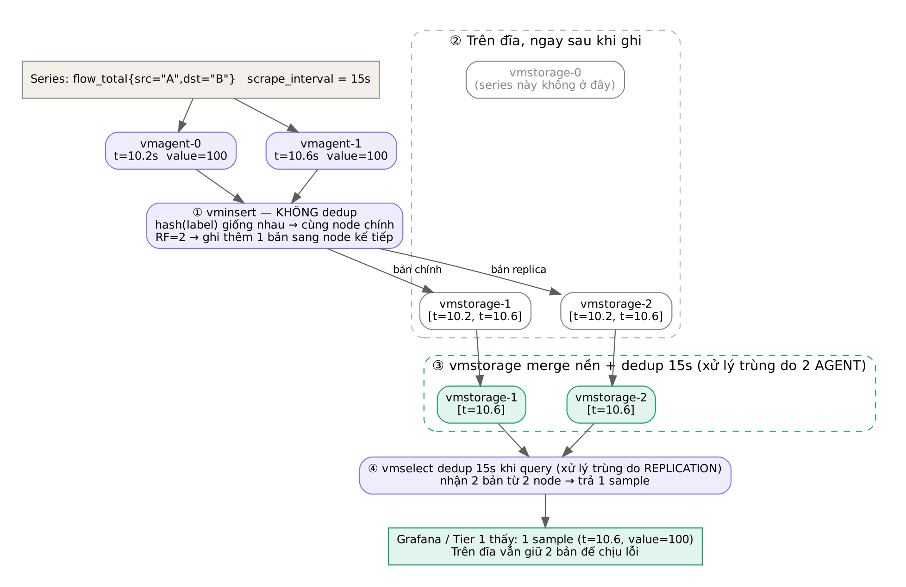

# 03 — Luồng metrics: dedup và replication



## 1. Đi theo một sample

Series `flow_total{src="A",dst="B"}`, `scrape_interval = 15s`.

**Bước 1: hai vmagent scrape.**

```
vmagent-0:  t=10.2s  value=100
vmagent-1:  t=10.6s  value=100
```

Hai sample có label **giống hệt nhau**, chỉ lệch timestamp. Cả hai được gửi tới vminsert.

**Bước 2: vminsert phân phối.** vminsert **không dedup**. Nó băm bộ label của series để chọn node:
- Cùng label thì cùng hash, nên **cả hai sample vào cùng node chính** (ví dụ vmstorage-1).
- RF=2 nên ghi thêm một bản sang node kế tiếp (vmstorage-2).

```
vmstorage-1: [t=10.2, t=10.6]
vmstorage-2: [t=10.2, t=10.6]
vmstorage-0: (không có series này)
```

**Bước 3: vmstorage merge nền và dedup.** Với `-dedup.minScrapeInterval=15s`, mỗi cửa sổ 15 giây chỉ giữ 1 sample (sample có timestamp lớn nhất).

```
vmstorage-1: [t=10.6]
vmstorage-2: [t=10.6]
```

Bản trùng do **2 agent** đã biến mất. Còn **2 bản trên 2 node vẫn được giữ** vì đó là replication có chủ đích.

**Bước 4: vmselect khi query.** vmselect hỏi mọi node, nhận 2 bản từ vmstorage-1 và vmstorage-2, gộp lại và trả **1 sample**.

vmselect cũng là lưới an toàn cho bước 3:
- Merge nền không chạy ngay, nên dữ liệu mới vẫn còn trùng cho tới khi merge.
- Khi một node tạm down, vminsert đẩy dữ liệu sang node khác (re-routing), khiến bản trùng nằm trên hai node khác nhau.

## 2. Tác động tới tài nguyên

| Tài nguyên | Ảnh hưởng của 2 agent | Lý do |
|---|---|---|
| Số series / index / RAM | **Không tăng** | Cùng label nên vẫn là 1 series |
| Đĩa | Tăng tạm thời, < 2× | Chỉ part chưa merge còn trùng; sample cùng value nén delta rất tốt |
| Network vmagent → vminsert | ×2 | Mỗi agent gửi riêng |
| vminsert → vmstorage | ×4 (2 agent × RF 2) | |
| CPU ingest vmstorage | ~×2 | |

Ở quy mô lab và Tier 1 thì con số này không đáng kể. Khi lên quy mô hàng triệu series, có thể dùng sharding kèm replication ngay trong vmagent:

```
-promscrape.cluster.membersCount=N
-promscrape.cluster.memberNum=i
-promscrape.cluster.replicationFactor=2
```

Với cấu hình này, mỗi target chỉ do 2 trên N agent scrape.

## 3. Kiểm chứng bằng số

```bash
make tc02
```

| Truy vấn | Kỳ vọng | Nếu dedup hỏng |
|---|---|---|
| `max(count_over_time(up{app="podinfo"}[5m]))` | ≈ 20 | ≈ 40 |
| `sum(rate(vm_rows_inserted_total{app="vminsert"}[5m]))` | ≈ 2 × tốc độ scrape của 1 agent | |

## 4. Khi Tier 1 đọc metrics

- Dùng `rate()` / `increase()` trên counter: dedup đã áp dụng nên không đếm đôi.
- Đọc qua vmauth: `http://vmauth:8427/select/0/prometheus/api/v1/query`.
- Nếu export raw (`/api/v1/export`), hãy kiểm tra lại số sample theo cách ở mục 3 trước khi dùng làm evidence weight.
