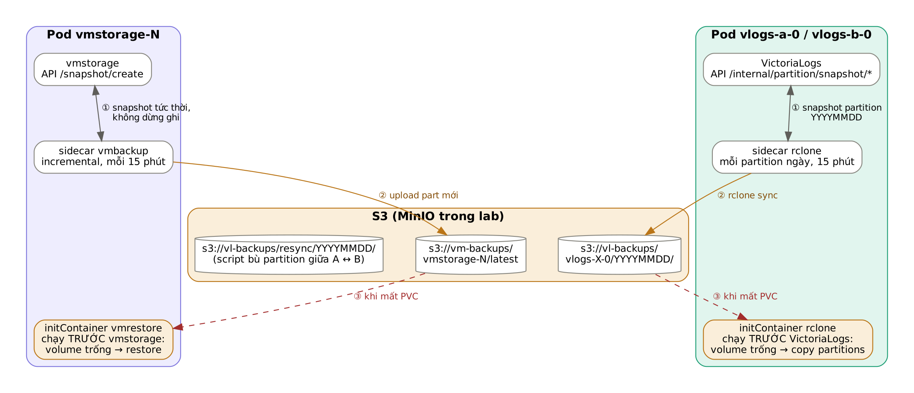

# 05 — Backup và tự phục hồi



## 1. Mục tiêu RPO / RTO (lab)

| | Metrics | Logs |
|---|---|---|
| Chu kỳ backup | 15 phút (`BACKUP_INTERVAL_SECONDS=900`) | 15 phút |
| RPO khi mất **1** instance | **0**: bản còn ở node replica | **0** khi đọc qua vmauth (A còn đủ); B tự thiếu ≤ 15 phút |
| RPO khi mất **toàn bộ** cluster | ≤ 15 phút | ≤ 15 phút |
| RTO tự phục hồi 1 instance | Thời gian tải backup (lab: vài chục giây) | Như metrics |

Muốn RPO nhỏ hơn thì giảm `BACKUP_INTERVAL_SECONDS`. Backup là incremental nên chu kỳ ngắn vẫn rẻ.

## 2. Bố cục trên S3

```
s3://vm-backups/
  vmstorage-0/latest/      # mỗi vmstorage một thư mục: mỗi node giữ tập dữ liệu KHÁC nhau
  vmstorage-1/latest/
  vmstorage-2/latest/
s3://vl-backups/
  vlogs-a-0/20261010/  20261011/ ...   # một thư mục cho mỗi partition ngày
  vlogs-b-0/20261010/  20261011/ ...
  resync/20261010/                     # vùng tạm khi bù partition giữa A <-> B
```

## 3. Metrics: vmbackup / vmrestore

**Backup** (`manifests/base/scripts/vm-backup-loop.sh`, sidecar trong pod vmstorage):

```
vmbackup -storageDataPath=/storage \
  -snapshot.createURL=http://127.0.0.1:8482/snapshot/create \
  -dst=s3://vm-backups/<pod>/latest -customS3Endpoint=http://minio:9000
```

- Snapshot của VictoriaMetrics là tức thời (dùng hard link), không dừng ghi.
- Lần đầu upload toàn bộ, các lần sau chỉ upload part mới.
- Khi lên production, nên thêm tầng daily/weekly bằng `-origin` (server-side copy): `-dst=s3://.../daily/YYYYMMDD -origin=s3://.../latest`.

**Restore tự động** (`vm-restore-if-empty.sh`, initContainer):

```
nếu /storage/data có dữ liệu → bỏ qua
ngược lại → vmrestore -src=s3://vm-backups/<pod>/latest
không có backup (cụm mới) → khởi động trống
```

initContainer chạy **trước** vmstorage, đúng yêu cầu của vmrestore (VictoriaMetrics phải đang dừng khi restore).

## 4. Logs: snapshot partition + rclone

**Backup** (`vl-backup-loop.sh`, sidecar trong pod VictoriaLogs). Mỗi vòng:

```
POST /internal/partition/list                              → ["20261010","20261011"]
mỗi partition p:
  POST /internal/partition/snapshot/create?partition_prefix=p → ["/vlogs/.../snapshot-path"]
  rclone sync <snapshot-path> s3:vl-backups/<pod>/p
  POST /internal/partition/snapshot/delete?path=<snapshot-path>
POST /internal/partition/snapshot/delete_stale?max_age=1h  (dọn snapshot mồ côi)
```

- Sidecar mount PVC ở **cùng đường dẫn** `/vlogs`, nên path snapshot do API trả về dùng được trực tiếp.
- Partition ngày cũ không đổi, nên `rclone sync` so sánh xong là bỏ qua.
- VictoriaLogs được chạy với `-snapshotsMaxAge=1d`: snapshot sót lại tự bị xóa sau 1 ngày.

**Restore tự động** (`vl-restore-if-empty.sh`, initContainer):

```
nếu /vlogs/partitions có dữ liệu → bỏ qua
ngược lại → rclone copy s3:vl-backups/<pod>/ /vlogs/partitions/
```

VictoriaLogs tự nạp các thư mục `partitions/YYYYMMDD` khi khởi động.

## 5. Khoảng thiếu sau khi restore logs và cách bù

Khi `vlogs-b` mất PVC lúc T, với lần backup cuối lúc T₀:

| Khoảng thời gian | Dữ liệu trên B sau khi restore |
|---|---|
| ≤ T₀ | Có (từ backup) |
| T₀ → T | **Thiếu**: đã ghi vào B nhưng chưa kịp backup |
| T → lúc B lên lại | Có: vlagent đã buffer và đẩy bù |

Khoảng thiếu T₀ → T **vẫn có trên A**, nên query qua vmauth vẫn đủ. Muốn B đủ trở lại:

```bash
# Bù một partition ngày ĐÃ KẾT THÚC từ A sang B
scripts/backup/vl-resync-partition.sh 20261010 a b
```

Script sẽ snapshot partition trên A, đẩy lên S3, rồi detach partition trên B, tải về và attach lại. Partition **hôm nay** đang nhận ghi nên script từ chối (trừ khi đặt `FORCE=1`). Với ngày hiện tại, hãy đợi sang ngày mới rồi chạy.

## 6. Thao tác tay

```bash
make backup-now      # backup ngay mọi instance
make list-backups    # xem dung lượng/thư mục trên S3
```

Restore tay một vmstorage (khi không muốn xóa PVC):

```bash
kubectl -n observability scale sts/vmstorage --replicas=2     # dừng vmstorage-2
# chạy pod tạm mount PVC storage-vmstorage-2 rồi chạy vmrestore (xem 07-runbook-lenh.md §5)
kubectl -n observability scale sts/vmstorage --replicas=3
```

## 7. Những điều backup KHÔNG giải quyết

- Dữ liệu sai đã được ghi vào sẽ bị backup luôn, vì `latest` bị ghi đè. Nên giữ thêm bản daily/weekly bằng `-origin` cho metrics, và bật versioning trên bucket.
- MinIO trong lab là single-node. Trên AWS, S3 thật cùng versioning và lifecycle policy giải quyết phần này.
